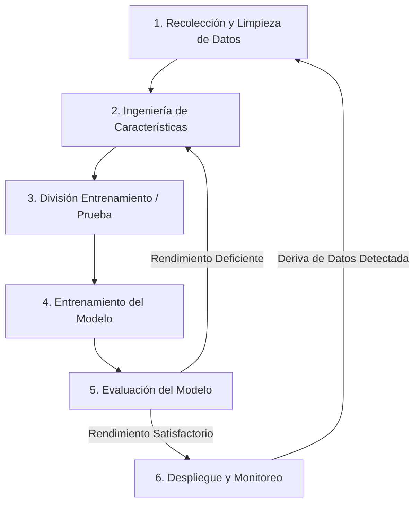

# Introducción Sólida al Machine Learning

## 1. ¿Qué es el Machine Learning?
El **Machine Learning (Aprendizaje Automático)** es una rama de la inteligencia artificial en la que las computadoras aprenden patrones a partir de datos históricos para hacer predicciones o tomar decisiones sin haber sido programadas explícitamente con reglas paso a paso.

### Fundamentos Teóricos
En esencia, el Machine Learning se apoya en tres pilares matemáticos:
* **Aproximación de Funciones:** En términos matemáticos, un modelo de ML intenta encontrar una función objetivo desconocida $f$ que relacione las variables de entrada ($X$) con una salida ($y$), expresada como $y = f(X) + \epsilon$, donde $\epsilon$ representa el ruido aleatorio irreducible.
* **Funciones de Pérdida y Optimización:** Un modelo mide qué tan equivocadas son sus predicciones mediante una **función de pérdida** (como el Error Cuadrático Medio o la Entropía Cruzada). Mejora utilizando algoritmos de optimización —principalmente el **Descenso del Gradiente**— para ajustar iterativamente sus parámetros internos (pesos) y minimizar ese error.
* **Generalización:** El objetivo teórico final del ML no es solo memorizar ejemplos pasados, sino **generalizar** bien ante datos futuros nunca vistos. Esto requiere equilibrar el **Sesgo (Bias)** (error por suposiciones demasiado simples) y la **Varianza (Variance)** (error por sensibilidad excesiva a pequeñas fluctuaciones en los datos de entrenamiento).

---

## 2. Los Tres Tipos Principales de Machine Learning

| Tipo | Cómo Aprende | Casos de Uso Comunes |
| :--- | :--- | :--- |
| **Aprendizaje Supervisado** | Aprende de datos etiquetados donde se proporcionan tanto las entradas ($X$) como las respuestas correctas ($y$). | Predicción de precios de acciones, detección de spam, diagnóstico médico. |
| **Aprendizaje No Supervisado** | Encuentra patrones ocultos o agrupaciones en datos sin etiquetar (solo $X$) y sin respuestas predefinidas. | Segmentación de clientes, detección de anomalías, agrupación de activos similares. |
| **Aprendizaje por Refuerzo** | Aprende mediante prueba y error realizando acciones en un entorno para maximizar recompensas acumuladas. | Bots de trading algorítmico, robótica, IA para videojuegos. |

---

## 3. Aprendizaje Supervisado vs. No Supervisado: ¿Cuándo Usar Cada Uno?

La elección entre aprendizaje supervisado y no supervisado depende principalmente de la **estructura de los datos** y del **objetivo del problema**.

### Usa Aprendizaje Supervisado Cuando:
* **Tienes etiquetas históricas:** Tu conjunto de datos ya contiene resultados conocidos (por ejemplo, impagos de crédito pasados, retornos históricos de activos o casos de fraude etiquetados).
* **Quieres predecir un resultado específico:** Tu objetivo es pronosticar un número (**Regresión**) o asignar una categoría conocida (**Clasificación**).
* **Necesitas métricas claras de precisión:** Como existen respuestas verdaderas en tu conjunto de prueba, puedes medir objetivamente el rendimiento con métricas como R-cuadrado, Exactitud (Accuracy), Precisión o Exhaustividad (Recall).
* **Ejemplo:** Usar `Volatility`, `Beta` y `Momentum` para predecir si el `Annual_Return` de una acción el próximo año será positivo o negativo.

### Usa Aprendizaje No Supervisado Cuando:
* **Tus datos no están etiquetados:** Tienes variables de entrada, pero ninguna columna con la "respuesta correcta" histórica para entrenar (y etiquetar manualmente es muy costoso o imposible).
* **Tu objetivo es explorar y descubrir estructuras:** Quieres descubrir segmentos ocultos, comprimir conjuntos de datos complejos o detectar valores atípicos (outliers) sin reglas predefinidas.
* **Estás preparando datos para tareas posteriores:** Técnicas no supervisadas como el Análisis de Componentes Principales (PCA) permiten reducir docenas de variables correlacionadas en unas pocas características limpias antes de alimentar un modelo supervisado.
* **Ejemplo:** Agrupar 500 acciones en clústeres naturales según su perfil de riesgo usando `Volatility` y `Max_Drawdown`, sin indicarle de antemano al algoritmo cuántos niveles de riesgo existen.

### Matriz Rápida de Decisión

| Criterio | Aprendizaje Supervisado | Aprendizaje No Supervisado |
| :--- | :--- | :--- |
| **Variable Objetivo ($y$)** | Presente y conocida | Ausente o desconocida |
| **Objetivo Principal** | Predicción y pronóstico | Descubrimiento de patrones y agrupación |
| **Esfuerzo Humano Inicial** | Alto (requiere datos etiquetados limpios) | Bajo (trabaja directo con variables crudas) |
| **Evaluación** | Comparación directa contra la verdad real | Indirecta (cohesión de clústeres, revisión experta) |

---

## 4. Tareas Principales Dentro del Aprendizaje Supervisado
La mayoría de los modelos prácticos de ML en negocios y finanzas se dividen en dos categorías:
* **Regresión:** Predice un valor numérico continuo. Por ejemplo, pronosticar el precio de un activo mañana o estimar su retorno anual.
* **Clasificación:** Predice una categoría o etiqueta discreta. Por ejemplo, decidir si una transacción es fraudulenta o legítima, o si una acción subirá o bajará.

---

## 5. El Flujo de Trabajo Estándar en Machine Learning

Construir un modelo de ML sigue un proceso iterativo y repetible desde los datos sin procesar hasta su despliegue en el mundo real.

### Diagrama de Flujo

### Desglose Paso a Paso
* **1. Recolección y Limpieza de Datos:** Reunir datos crudos y corregir valores faltantes, duplicados o valores atípicos. Tener datos limpios importa mucho más que usar algoritmos complejos.
* **2. Ingeniería de Características (Feature Engineering):** Seleccionar y transformar variables crudas (como convertir precios diarios en `Volatility` o `Momentum`) para que el modelo detecte patrones con mayor facilidad.
* **3. División Entrenamiento / Prueba (Train/Test Split):** Dividir los datos en un conjunto de entrenamiento (usualmente 70–80%) para enseñar al modelo, y un conjunto de prueba (20–30%) para evaluarlo con datos no vistos sin fuga de información.
* **4. Entrenamiento del Modelo:** Alimentar un algoritmo (como Regresión Lineal, Random Forest o Redes Neuronales) con los datos de entrenamiento para encontrar los parámetros matemáticos óptimos.
* **5. Evaluación del Modelo:** Medir la precisión en el conjunto de prueba usando métricas adecuadas para la tarea, como el Error Cuadrático Medio para regresión o Precisión y Recall para clasificación. Si el rendimiento es bajo, se regresa a la Ingeniería de Características o se ajustan los hiperparámetros.
* **6. Despliegue y Monitoreo:** Poner el modelo en producción y supervisarlo a lo largo del tiempo para detectar pérdida de rendimiento conforme cambian los datos del mundo real.

---

## 6. Conceptos Teóricos Clave para Conocer Desde el Principio
* **Sobreajuste vs. Subajuste (Overfitting vs. Underfitting):** El sobreajuste ocurre cuando un modelo memoriza el ruido aleatorio de los datos de entrenamiento y falla con datos nuevos (alta varianza). El subajuste ocurre cuando un modelo es demasiado simple para capturar la tendencia subyacente (alto sesgo).
* **Características ($X$) vs. Objetivo ($y$):** Las características son las variables de entrada usadas para predecir. El objetivo es el resultado específico que deseas predecir.
* **Fuga de Datos (Data Leakage):** Permitir accidentalmente que información del conjunto de prueba —o datos del futuro— se filtre en el proceso de entrenamiento, generando métricas artificialmente altas que luego fallan en entornos reales.
