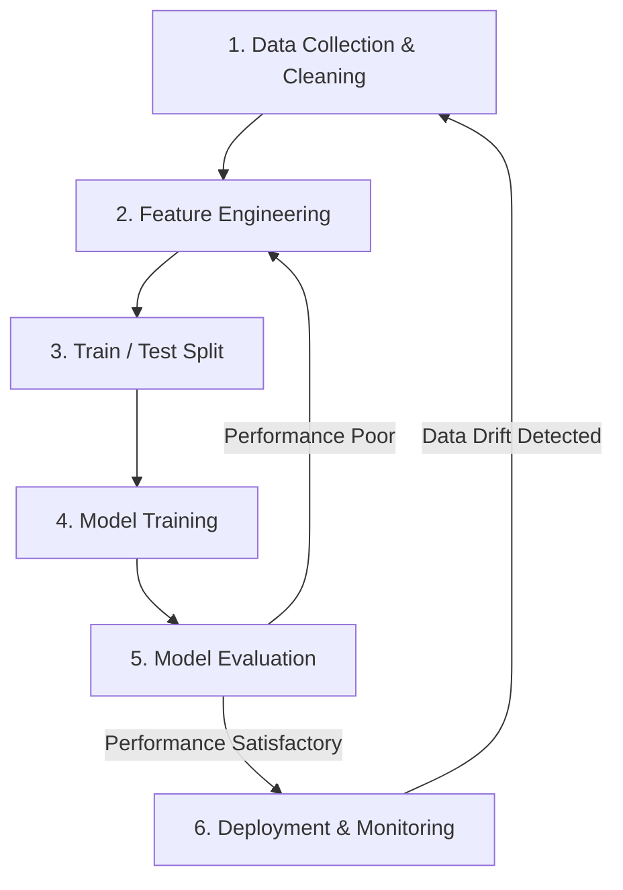

# Solid Introduction to Machine Learning

## 1. What is Machine Learning?
**Machine Learning (ML)** is a branch of artificial intelligence where computers learn patterns from historical data to make predictions or decisions without being explicitly programmed with step-by-step rules.

### Theoretical Foundations
At its core, Machine Learning relies on three mathematical pillars:
* **Function Approximation:** In mathematical terms, an ML model tries to find an unknown target function $f$ that maps input variables ($X$) to an output ($y$), expressed as $y = f(X) + \epsilon$, where $\epsilon$ represents irreducible random noise.
* **Loss Functions & Optimization:** A model measures how wrong its predictions are using a **loss function** (such as Mean Squared Error or Cross-Entropy). It improves by using optimization algorithms—most notably **Gradient Descent**—to iteratively adjust internal parameters (weights) and minimize that error.
* **Generalization:** The ultimate theoretical goal of ML is not just memorizing past examples, but **generalizing** well to unseen future data. This requires balancing **Bias** (error from overly simplistic assumptions) and **Variance** (error from excessive sensitivity to small fluctuations in the training set).

---

## 2. The Three Main Types of Machine Learning

| Type | How It Learns | Common Use Cases |
| :--- | :--- | :--- |
| **Supervised Learning** | Learns from labeled data where both the inputs ($X$) and the correct answers ($y$) are provided. | Predicting stock prices, spam detection, medical diagnosis. |
| **Unsupervised Learning** | Finds hidden patterns or groupings in unlabeled data ($X$ only) without predefined answers. | Customer segmentation, anomaly detection, grouping similar assets. |
| **Reinforcement Learning** | Learns through trial and error by taking actions in an environment to maximize cumulative rewards. | Algorithmic trading bots, robotics, game-playing AI. |

---

## 3. Supervised vs. Unsupervised Learning: When to Use Which?

Choosing between supervised and unsupervised learning depends primarily on **data structure** and **business objective**.

### Use Supervised Learning When:
* **You have historical labels:** Your dataset already contains known outcomes (e.g., past credit defaults, historical asset returns, or labeled fraud cases).
* **You want to predict a specific outcome:** Your goal is forecasting a number (**Regression**) or assigning a known category (**Classification**).
* **You need clear accuracy metrics:** Because true answers exist in your test set, you can objectively measure performance using metrics like R-squared, Accuracy, Precision, or Recall.
* **Example:** Using `Volatility`, `Beta`, and `Momentum` to predict whether a stock's `Annual_Return` next year will be positive or negative.

### Use Unsupervised Learning When:
* **Your data is unlabeled:** You have raw features, but no historical "right answer" column to train against (and labeling manually is too expensive or impossible).
* **Your goal is exploration and structure discovery:** You want to uncover hidden segments, compress complex datasets, or spot unusual outliers without predefined rules.
* **You are preparing data for downstream tasks:** Unsupervised techniques like Principal Component Analysis (PCA) can reduce dozens of correlated variables into a few clean features before feeding them into a supervised model.
* **Example:** Grouping 500 stocks into natural risk-profile clusters based on `Volatility` and `Max_Drawdown` without telling the algorithm how many risk tiers exist beforehand.

### Quick Decision Matrix

| Criterion | Supervised Learning | Unsupervised Learning |
| :--- | :--- | :--- |
| **Target Variable ($y$)** | Present and known | Absent or unknown |
| **Primary Goal** | Prediction and forecasting | Pattern discovery and grouping |
| **Human Effort Upfront** | High (requires clean labeled data) | Low (works directly on raw features) |
| **Evaluation** | Direct comparison against ground truth | Indirect (cluster cohesion, domain inspection) |

---

## 4. Core Tasks Within Supervised Learning
Most practical business and financial ML models fall into two categories:
* **Regression:** Predicts a continuous numerical value. For example, forecasting tomorrow's asset price or estimating annual return.
* **Classification:** Predicts a discrete category or label. For example, deciding whether a transaction is fraudulent or non-fraudulent, or whether a stock will go up or down.

---

## 5. The Standard Machine Learning Workflow

Building an ML model follows an iterative, repeatable pipeline from raw data to real-world deployment.

### Workflow Diagram

### Step-by-Step Breakdown
* **1. Data Collection & Cleaning:** Gathering raw data and fixing missing values, duplicates, or outliers. Clean data matters far more than complex algorithms.
* **2. Feature Engineering:** Selecting and transforming raw inputs (like turning daily prices into `Volatility` or `Momentum`) so the model can spot patterns easier.
* **3. Train/Test Split:** Dividing data into a training set (usually 70–80%) to teach the model, and a testing set (20–30%) to evaluate it on unseen data without data leakage.
* **4. Model Training:** Feeding the training data into an algorithm (such as Linear Regression, Random Forest, or Neural Networks) to find optimal mathematical parameters.
* **5. Model Evaluation:** Measuring accuracy on the test set using metrics suited to the task, like Mean Squared Error for regression or Precision and Recall for classification. If performance lags, return to Feature Engineering or tune hyperparameters.
* **6. Deployment & Monitoring:** Putting the model into production and tracking it over time to catch performance decay as real-world data shifts.

---

## 6. Key Theoretical Concepts to Know Early
* **Overfitting vs. Underfitting:** Overfitting happens when a model memorizes random noise in the training data and fails on new data (high variance). Underfitting happens when a model is too simple to capture the underlying trend (high bias).
* **Features ($X$) vs. Target ($y$):** Features are the input variables used to make predictions. The target is the specific outcome you want to predict.
* **Data Leakage:** Accidentally allowing information from the test set—or future timestamps—to leak into the training process, creating artificially high test scores that fail in live environments.
